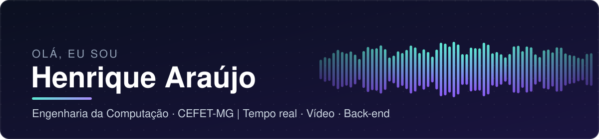
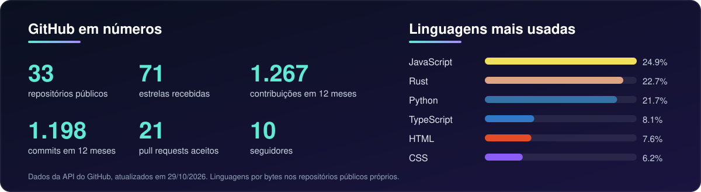

 

Estudante de **Engenharia da Computação no CEFET-MG (Divinópolis)**, apaixonado por **sistemas de alta performance, vídeo em tempo real e back-end seguro**. Gosto de construir coisas do zero e colocá-las em produção.

---

## 🚀 Em destaque: Litecord

Cliente Discord **nativo e leve**, escrito do zero em Rust. Envio de tela **1080p60** com captura, conversão e codificação H.264 na GPU (NVENC, Quick Sync, AMF), voz com Opus e criptografia E2EE, transmissão sob demanda e para navegador por link. Em produção, com releases e updater.

---

## 📦 Outros projetos

<table>
  <tr>
    <td width="50%" valign="top">
      <a href="https://github.com/Ak4ai/Stremio_For_Gamepad"><b>🎮 Stremio for Gamepad</b></a> 
      Interface de TV (10-foot) para o Stremio, feita para controle, TV e Steam Deck, com player HLS e release automatizada.  
      
      
      
    </td>
    <td width="50%" valign="top">
      <a href="https://github.com/Ak4ai/decky-trailer-hero"><b>🎬 Trailer Hero</b></a> 
      Plugin do Decky Loader que toca trailers no Steam Big Picture, lendo manifestos DASH e segmentos fMP4, com testes unitários.  
      
      
    </td>
  </tr>
  <tr>
    <td width="50%" valign="top">
      <a href="https://github.com/Ak4ai/Sigaa-API-webapp"><b>📚 Consulta SIGAA</b></a> · <a href="https://github.com/Ak4ai/sigaa-api-backend">API</a> 
      PWA offline e API com sessões seguras, rate limiting, fila de consultas e deploy com rollback. Base do projeto de extensão SAFE (CEFET-MG).  
      
      
      
    </td>
    <td width="50%" valign="top">
      <a href="https://github.com/Ak4ai/CEFETCON"><b>🎭 CEFETCON</b></a> 
      Sistema de avaliação do concurso de cosplay do evento: painel administrativo, votação de jurados em duas modalidades e autenticação JWT.  
      
      
      
    </td>
  </tr>
  <tr>
    <td width="50%" valign="top">
      <a href="https://github.com/Ak4ai/Isometricon"><b>🧊 Isometricon</b></a> 
      Engine 3D de tabletop virtual em voxels, feita em equipe: álgebra linear, compilador de shaders GLSL e CI de release multiplataforma.  
      
      
    </td>
    <td width="50%" valign="top">
      <a href="https://github.com/SrRapero720/waterframes"><b>🧩 waterframes</b></a> (contribuição) 
      Port do mod de Minecraft para a 1.21.8, com PR aceito no repositório original.  
      
    </td>
  </tr>
</table>

---

## 🛠️ Tecnologias

---

## 📊 GitHub em números

---

## 🤝 Também por aí

- Dashboard de indicadores de saúde para a SEMUSA de Divinópolis (projeto integrador do CEFET-MG): autenticação, perfis de acesso e auditoria.
- Extensionista voluntário no projeto **SAFE** (CEFET-MG).

## 📫 Contato

Feito em Divinópolis, MG 🇧🇷

